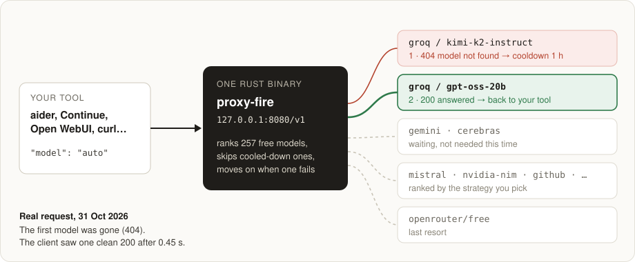
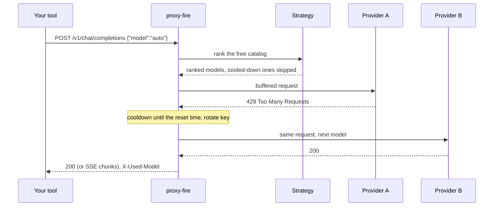

<div align="center">

# proxy-fire

### Free LLM inference that doesn't run dry.

**One Rust binary turns every free LLM tier you have into a single OpenAI-compatible endpoint.**<br>
**When Groq says 429, your request moves on to Gemini, Cerebras or OpenRouter, and your tool never notices.**

[](https://github.com/leloush-x/proxy-fire/actions/workflows/ci.yml)
[](https://github.com/leloush-x/proxy-fire/releases/latest)
[](Cargo.toml)
[](.github/workflows/ci.yml)
[](LICENSE)

[**Free model list**](FREE_MODELS.md) · [Install](#install) · [PicoClaw & small boards](#run-it-beside-picoclaw-on-a-10-board) · [Strategies](#pick-a-strategy) · [How it works](#how-it-works) · [Limits](#honest-limits)

</div>

> **Try it in one minute.** You need one free key from [Groq](https://console.groq.com/keys) (no credit card). No Rust toolchain, no config file. On Linux or macOS:
>
> ```bash
> VERSION=0.1.4
> curl -fsSL https://github.com/leloush-x/proxy-fire/releases/download/v$VERSION/proxy-fire_${VERSION}_$(uname -s | tr A-Z a-z)_$(uname -m | sed 's/x86_64/amd64/;s/aarch64/arm64/;s/armv6l/armv6/;s/armv7l/armv7/').tar.gz | tar xz
> GROQ_API_KEY=gsk_... ./proxy-fire
> ```
>
> In a second terminal:
>
> ```bash
> curl -si localhost:8080/v1/chat/completions -H 'Content-Type: application/json' \
>   -d '{"model":"auto","messages":[{"role":"user","content":"In one sentence: why do free LLM tiers run dry?"}]}'
> ```
>
> The `X-Used-Model` header tells you which free model answered. The archive brings its own provider list and a catalog of 253 free models. Linux: the `.tar.gz` on the [releases page](https://github.com/leloush-x/proxy-fire/releases/latest), or Docker (see [Install](#install)).

<p align="center">
  
</p>

## The idea

Groq, Google AI Studio, Cerebras, OpenRouter, GitHub Models, Mistral and NVIDIA all give away LLM inference on official API keys. Each tier is generous on its own, but small: a few requests per minute, a daily cap, models that disappear without notice. A script or a coding agent that leans on one of them stops working by the afternoon. Wiring all of them together by hand means juggling base URLs, model names, rate-limit headers and cooldowns in every tool.

This proxy does that once, locally, for every tool you use.

| Without | With |
|---|---|
| One provider's 429 stops your agent mid-task | The request moves on to the next free model; your agent sees a normal 200 |
| A model gets retired and your config breaks | A 404 puts that model on cooldown and the next one answers |
| Every tool needs its own key, base URL and model name | Every tool points at `localhost:8080/v1` and asks for `auto` |
| You keep your own list of which models are free this week | [`FREE_MODELS.md`](FREE_MODELS.md) is rebuilt every week by scanning the providers' model APIs |
| Quotas reset at different times, and you track them in your head | Per-model cooldowns, reliability scores and daily usage are tracked and kept across restarts |

## How it works

1. **Your tool** sends a normal OpenAI chat request, with `model` set to `auto`, a strategy (`coding`, `speed`, `long_context`…), an agent profile, or a specific model.
2. **The strategy** ranks the free models in the catalog, for example *"largest context window first"* or *"fastest provider first"*.
3. **The fallback chain** tries them in order. It skips models on cooldown and moves on when a provider fails.

   | Upstream says | The proxy does |
   |---|---|
   | `429` rate limited | cools down that model on that key until the provider's reset time, and retries it at once with your next key if you have several |
   | `400` bad request | skips that provider for this request and cools down that model for an hour (`413`/`422`: skip only) |
   | `404` model not found | cools down that model for an hour |
   | `401`/`403` bad key | a pooled key cools only that slot for ten minutes; a single key cools the provider |
   | timeout or connection error | moves on and lowers that provider's reliability score |
   | `200` with no content | tries another model; an empty reply cut off by `max_tokens` is kept only as a last resort |
4. **The first good answer** goes back to your tool. If you asked for `stream: true`, it arrives as standard SSE chunks.
5. **If every free model fails**, or `fallback.request_timeout` (90 s) passes, you get `503` with a `Retry-After` header, never a fake answer.

## Why not a full AI gateway?

LiteLLM and [OmniRoute](https://github.com/diegosouzapw/OmniRoute) are great when you want hundreds of providers, paid-key budgets and a web dashboard. This project is deliberately smaller:

| | proxy-fire | Full AI gateways |
|---|---|---|
| Install | one static binary, about 11 MB | Node or Python runtime, Docker, often a database |
| Scope | **free tiers only**: official, recharging, no card | paid, free and subscription logins |
| Terms of service | official API keys only, no OAuth or session reuse | some route through consumer subscriptions |
| Code you have to trust | about 7.9k lines of Rust in five small crates, readable in an afternoon | very large codebases |
| Free-model catalog | discovered from the providers' model APIs, [refreshed weekly](FREE_MODELS.md) | curated lists |
| Runs on | laptop, Raspberry Pi (Zero included), RISC-V boards, NAS, $4 VPS, CI runner | servers |

## Use it with your tools

Anything that speaks the OpenAI API works. Point it at the proxy and use any API key, because the proxy holds the real ones:

```bash
export OPENAI_BASE_URL=http://localhost:8080/v1   # OpenAI SDKs, LangChain, most CLIs
export OPENAI_API_BASE=http://localhost:8080/v1   # older tools, e.g. aider
export OPENAI_API_KEY=unused                      # or your proxy.auth_token
```

In GUI tools (Continue, Cline, Open WebUI, LibreChat…), add an "OpenAI-compatible" provider with base URL `http://localhost:8080/v1`. `GET /v1/models` lists `auto`, every strategy, your agent profiles and all free models, so they show up in model pickers.

## Run it beside PicoClaw on a $10 board

[PicoClaw](https://github.com/sipeed/picoclaw) runs an AI agent on a Pi Zero or a Sipeed RISC-V board. It still needs a model API, and a single free tier runs dry fast. Run this proxy **on the same board** and PicoClaw gets every free tier you have, with fallback, through one local endpoint.

Add it to PicoClaw's `config.json` as a custom OpenAI-compatible provider ([PicoClaw's provider docs](https://github.com/sipeed/picoclaw/blob/main/docs/guides/providers.md)):

```json
{
  "model_list": [
    {
      "model_name": "free",
      "provider": "openai",
      "model": "auto",
      "api_base": "http://localhost:8080/v1",
      "api_keys": ["unused"]
    }
  ],
  "agents": { "defaults": { "model_name": "free" } }
}
```

Use `"model": "coding"`, `"speed"` or any other [strategy](#pick-a-strategy) in place of `auto`.

| | Measured (Nov 2026) |
|---|---|
| Binary | one stripped Rust binary, no runtime to install |
| Memory | a few MB resident when idle (catalog of 250 models loaded) |
| Builds for | `linux/amd64` + `linux/arm64` (static musl) |

Prebuilt binaries are on the releases page (static musl for Linux). To build for other targets, cross-compile from any machine with Rust and copy the result over:

```bash
cargo build --release --target armv7-unknown-linux-musleabihf
scp target/armv7-unknown-linux-musleabihf/release/proxy-fire configs/ pi@raspberrypi.local:~/proxy-fire/
```

## Pick a strategy

Put a strategy name in the `model` field, or set the default in `config.yaml`:

| Strategy | Picks | Good for |
|---|---|---|
| `auto` / `adaptive` | reliability-weighted ranking that adjusts over time | everyday use |
| `performance` | the largest model available | hard questions |
| `speed` | fastest providers first (Cerebras, Groq) | chat, autocomplete |
| `volume` | highest daily request limits | batch jobs |
| `coding` | models with code capability | coding agents |
| `long_context` | largest context window first | long documents |
| `balanced` | 14–79B models | quality per token |
| `small` / `tiny` | 3–13B / under 3B models | low latency |
| `reliable` | highest measured success rate | unattended scripts |
| `economical` | recharging free tiers before credit-based ones | saving credits |
| `similar` | the same model family as a reference model | consistency |
| `parallel` | several models for fan-out | comparisons |

**Agent profiles** bundle a strategy or a pinned model with defaults, so each tool can ask for its own name. The bundled config defines `coding`, `summariser`, `reliable`, `long-context` and `precise`:

```yaml
proxy:
  agents:
    coding:
      strategy: "coding"
      defaults: { temperature: 0.2, max_tokens: 8192 }   # client values win
    summariser:
      strategy: "volume"
      overrides: { max_tokens: 512 }                      # always applied
```

A pinned model that has left the free catalog falls back to the profile's strategy instead of failing.

## Providers

**253 free models across 9 providers**, from the scan of 9 Nov 2026 ([full list](FREE_MODELS.md)). One key is enough to start, and every extra key adds capacity.

**Cline accounts as a provider.** `proxy-fire login` has a native **cline** option: it runs the official WorkOS device-authorization flow in your browser, registers the session with Cline, and stores your account's refresh token in `~/.proxy-fire/.env` as `CLINE_REFRESH_TOKEN` (extra accounts go in `CLINE_REFRESH_TOKEN_2…_9`). The free tier is a rotating promotion — models may change — so `proxy-fire scan update` refreshes the catalog from Cline's recommended-models endpoint; seed entries ship in the bundled catalog. Free-tier daily inference caps (HTTP 429 `INFERENCE_CAP_ERROR`, body says "Try again in …") bench that account until reset; rejected accounts are benched 10 minutes. Upstream responses are always streamed and reassembled server-side, so clients see one clean completion.

| Provider | Free models | Get a key |
|---|---:|---|
| Cline | 3 | `proxy-fire login` → pick **cline** (WorkOS browser auth, no API key) |
| NVIDIA NIM | 70 | [build.nvidia.com](https://build.nvidia.com) |
| Mistral | 50 | [console.mistral.ai](https://console.mistral.ai) |
| HuggingFace | 48 | [huggingface.co/settings/tokens](https://huggingface.co/settings/tokens) |
| GitHub Models | 35 | any [GitHub token](https://github.com/settings/tokens) |
| Google AI Studio (Gemini) | 21 | [aistudio.google.com/app/apikey](https://aistudio.google.com/app/apikey) |
| OpenRouter | 14 | [openrouter.ai/settings/keys](https://openrouter.ai/settings/keys) |
| Groq | 10 | [console.groq.com/keys](https://console.groq.com/keys) |
| Cerebras | 2 | [cloud.cerebras.ai](https://cloud.cerebras.ai) |
| Ollama (local) | your models | no key |

Several keys per provider are pooled automatically — three ways to set them:

- numbered vars: `GROQ_API_KEY`, `GROQ_API_KEY_2`, `GROQ_API_KEY_3`… (up to `_9`)
- a comma-separated pool: `GROQ_API_KEYS=gsk_aaa,gsk_bbb,gsk_ccc`
- on the per-provider `api_key` field (comma-separated values also work)
- Cline accounts: `CLINE_REFRESH_TOKEN`, `CLINE_REFRESH_TOKEN_2`… (via `proxy-fire login`)

The router spreads load across the pool round-robin, retries the same model with the next key on a 429, and puts only the rejected key on cooldown when a provider answers 401/403 — the rest of the pool keeps serving. Free tiers change often, so check each provider's own terms.

## Install

| | Command |
|---|---|
| **Docker** (amd64, arm64) | `docker run --rm -p 0.0.0.0:8080:8080 -e GROQ_API_KEY=gsk_... ghcr.io/leloush-x/proxy-fire:latest` |
| **Archive** (Linux) | `.tar.gz` on the [releases page](https://github.com/leloush-x/proxy-fire/releases/latest); keep `configs/` next to the binaries |
| **cargo** | `cargo install --git https://github.com/leloush-x/proxy-fire proxy-fire --bin proxy-fire` (binary only, so pass `-c config.yaml`) |
| **From source** | `git clone … && make build` (the binary lands in `bin/`) |

Every package ships one binary plus `configs/` (the provider definitions and the free-model catalog):

| Binary | Does |
|---|---|
| `proxy-fire` | **the one binary** — the OpenAI-compatible proxy, plus `scan` subcommands (`scan update`, `scan probe`, `scan refresh-llm`, `scan export-md`) and `bench` for benchmarking; `proxy-fire update` self-updates from the latest GitHub release |

<details>
<summary><b>Install, step by step</b></summary>

```bash
VERSION=0.1.4
# macOS on Apple Silicon, from the archive
curl -LO https://github.com/leloush-x/proxy-fire/releases/download/v$VERSION/proxy-fire_${VERSION}_darwin_arm64.tar.gz
tar xzf proxy-fire_${VERSION}_darwin_arm64.tar.gz && ./proxy-fire --help

# or build from source
git clone https://github.com/leloush-x/proxy-fire && cd proxy-fire
make build
```

</details>

### Keys and config

Keys are read from, first match wins:

1. environment variables (`export GROQ_API_KEY=...`)
2. `.env` in the working directory (see [`.env.example`](.env.example) for every supported key)
3. `~/.proxy-fire/.env` or `.secrets`, which work from any directory

Config is read from `-c path`, `./config.yaml` or `~/.proxy-fire/config.yaml`, and falls back to the bundled [`configs/config.example.yaml`](configs/config.example.yaml). Start it with `-c path/to/config.yaml` and most edits apply without a restart (`auth_token` and `host` need one). `bash scripts/setup.sh` writes a starter config to `~/.proxy-fire/`.

```yaml
proxy:
  strategy: "adaptive"   # default when a request says "auto"
  host: "0.0.0.0"        # "127.0.0.1" for localhost-only
  port: 8080
  auth_token: "fire"     # Bearer token clients must send (default: "fire")
```

**It listens on `0.0.0.0` by default and requires the bearer token `fire`** (change `proxy.auth_token`; set it to `""` for open access on localhost). On startup the proxy prints its OpenAI-compatible base URL(s) and API key to the log. `GET /models`, `POST /chat/completions` and the `/v1/...` routes are all served. The Docker image listens on all interfaces inside the container, so publish the port on localhost (`-p 127.0.0.1:8080:8080`) or change `proxy.auth_token`.

### Keep the catalog fresh

```bash
./bin/proxy-fire scan update      # rescan your providers, write the catalog
./bin/proxy-fire scan export-md   # render it as a Markdown list
```

Or let one machine scan on a schedule and every other machine pull the result: see `catalog.git_sync` in the config.

## API

| Endpoint | Does |
|---|---|
| `POST /v1/chat/completions` | chat, streaming or not, routed through the fallback chain |
| `GET /v1/models` | `auto`, strategies, agent profiles and every free model |
| `GET /health` | liveness check |

| Response header | Means |
|---|---|
| `X-Used-Model` | the model that actually answered |
| `X-Cache: HIT` | served from the short response cache (non-streaming only) |
| `X-Proxy-Exhausted` + `Retry-After` | every free model failed (`503`); retry after that many seconds |

<details>
<summary><b>Architecture</b></summary>



```
crates/
  core/             domain logic (no network): config, catalog, strategy,
                    ratelimit, reliability, model classification
  providers/        one module per provider behind a `Provider` trait;
                    the fallback chain talks only to the trait
  proxy/            HTTP handlers, fallback chain, SSE re-emission, cache
  scan/             scan dispatcher + cross-provider family correlation
  cli/              the one all-in-one binary: `proxy-fire` (proxy + `scan` + `bench` subcommands)
configs/            bundled config and the free-model catalog
```

</details>

## Honest limits

- **Free tiers are small, and they change.** The proxy makes the most of them. It does not create capacity, and it is not a fit for production traffic with an SLA.
- **Streaming is buffered.** Providers are called without streaming so that a failure can fall back mid-request; the answer is re-emitted as SSE once it is complete. Time to first token equals the full response time.
- **The catalog can lag a provider's change by up to a week.** Models that vanish are cooled down on the first 404 and skipped.
- **Local quota tracking is best-effort.** The proxy honours the providers' rate-limit headers, but under heavy concurrency a provider may still send the occasional 429, which simply triggers the fallback.

## Development

```bash
cargo test --workspace   # unit + integration tests
cargo clippy --workspace --all-targets -- -D warnings
cargo build --release --workspace
```

## Contributors

Thank you to everyone who has helped make this better:

- [@BenediktChlopik](https://github.com/BenediktChlopik): empty-completion detection, so a `200` with no content is never passed off as an answer ([#16](https://github.com/leloush-x/proxy-fire/pull/16), [#17](https://github.com/leloush-x/proxy-fire/pull/17)), and new free providers ([#15](https://github.com/leloush-x/proxy-fire/pull/15))

## Acknowledgments

Free-tier limits and change tracking are informed by [cheahjs/free-llm-api-resources](https://github.com/cheahjs/free-llm-api-resources), the community reference for free LLM APIs.

---

<div align="center">

Built by [kaiser-data](https://github.com/kaiser-data) · MIT licensed · Issues and PRs welcome<br>
Keys stay in your environment or `.env`; never commit them.

</div>
